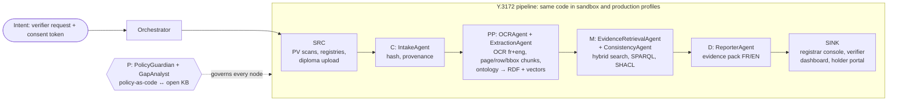

# VeriDiplo — Moteur de recherche de preuves documentaires et authentification de diplômes

> **SPECIMEN – SYNTHETIC DATA.** Every institution, person, diploma and deliberation minute in this repository is
> fictional and generated. No real personal data, logo, stamp or signature is used.

*Built for the ITU **AI for Good** Sandbox Hackathon — Cameroon.*

🇫🇷 **Résumé.** Vérifier un diplôme au Cameroun prend des mois : les preuves sont dispersées entre procès-verbaux de
délibération scannés, listes de résultats PDF, registres et archives papier. VeriDiplo retrouve rapidement ces preuves,
compare chaque champ du diplôme aux sources institutionnelles et rend un **verdict prudent** — jamais « faux » —
accompagné d'un **dossier de preuves** (document, page, ligne, zone surlignée), des **règles de politique** appliquées
(reliées à de vrais textes juridiques) et des **lacunes de politique** détectées. Un **registraire humain** valide
chaque verdict `INCONSISTENT` avant communication.

🇬🇧 **Summary.** Evidence that a Cameroonian diploma is genuine is scattered across scanned deliberation minutes (PV),
result lists and registries, so verification takes months. VeriDiplo finds the corroborating records, checks each
diploma field against institutional sources and returns a cautious verdict, an evidence pack with page/row/bounding-box
citations, the policy rules that fired (each linked to a real legal text) and any policy gap. A human registrar approves
every `INCONSISTENT` verdict before it is communicated.

---

## What it answers

*How can we quickly find the relevant documentary evidence and establish whether the information on a diploma is
consistent with the available institutional sources?*

A verifier (employer, ministry, embassy) submits a diploma **plus the holder's consent token**. The agents return:

| Output | Details |
|---|---|
| **Verdict** | `CONSISTENT`, `INCONSISTENT` or `INSUFFICIENT_EVIDENCE`. The system never outputs "fake / faux". |
| **Evidence pack** | Source document, page, row and bounding box, with a highlighted image crop and a SHA-256 integrity hash. |
| **Policy rules fired** | Each rule is linked to a chunk of a real, public legal text in the open knowledge base. |
| **Policy gaps** | Any decision that no existing policy covers is recorded in a gap register. |

## Version A vs Version B

The same pipeline runs in two modes on identical scenarios (`POLICY_MODE=off|on`):

- **Version A — ungoverned** (`off`): no Policy Guardian, no Gap Analyst, naive wording (it may say "FAKE").
- **Version B — policy-governed** (`on`, default): consent checks, bulk-query limits, no-accusation wording, mandatory
  registrar approval, data minimisation for cross-border requests, hash-chained audit trail.

| ID | Scenario | Version A (off) | Version B (on) |
|---|---|---|---|
| S1 | Genuine licence, consent present | CONSISTENT | CONSISTENT + citations + audit |
| S2 | Mention Passable→Bien, average raised | text contains "FAKE" | INCONSISTENT, no accusation, escalated to registrar, holder notified |
| S3 | HR firm, 200 names, no consent | returns records | BLOCKED (PR-CONSENT, PR-BULK) + gap P5 |
| S4 | UAE employer via embassy | full transcript returned | minimal attestation + transfer flag (Art. 32) + comparative gap |
| S5 | 1998 PV missing | guesses (similar name) | INSUFFICIENT_EVIDENCE + archive request draft + gap P2 |
| S6 | OCR-hard / reversed name order | false INCONSISTENT | `unknown` → human review, rectification path |
| S7 | Registrar approves without justification | accepted | rejected + supervisor alert |

`make demo` runs S1–S7 in both modes and writes `docs/ab_results.md`.

---

## Quick start

Prerequisites: Docker with Compose v2, about 6 GB free RAM, and internet access for the first build only. After that
the demo works **offline and without any API key** (`LLM_PROVIDER=none` uses deterministic templates).

```bash
cp .env.example .env     # defaults are fine
make up                  # build and start db, kg, api, worker, ui
make seed                # generate synthetic data, build KB, ingest archives, load the knowledge graph
make demo                # run S1–S7 in modes A and B → docs/ab_results.md
```

| Service | URL |
|---|---|
| UI (Streamlit) | http://localhost:8501 |
| API (FastAPI docs) | http://localhost:8000/docs |
| Oxigraph SPARQL | http://localhost:7878 |

Other targets: `make test`, `make logs`, `make ps`, `make shell`, `make down`, `make reset` (destroys volumes),
`make llm` (adds the optional local Ollama service). Host ports are configurable in `.env`
(`API_PORT`, `UI_PORT`, `DB_PORT`, `KG_PORT`).

**Switching mode** — set `POLICY_MODE=on|off` in `.env`, or call `POST /cases/{id}/run?policy_mode=off`.
The A/B page of the UI runs both and shows a side-by-side diff.

---

## Architecture (ITU-T Y.3172)



| Y.3172 node | Component | Policy checkpoint |
|---|---|---|
| SRC → C | `IntakeAgent` (SHA-256, provenance, routing) | `before_ingest` |
| PP | `OCRAgent`, `ExtractionAgent` (Tesseract fra+eng, PV tables → RDF) | — |
| M | `EvidenceRetrievalAgent`, `ConsistencyAgent` (checks C1–C8) | `before_search` |
| P | `PolicyGuardianAgent`, `GapAnalystAgent` | all checkpoints |
| D | `ReporterAgent` (evidence pack, bilingual explanation, hash) | `before_report` |
| SINK | Registrar console, verifier dashboard | `before_share`, `before_export_abroad` |

The detailed node-by-node mapping and the standards gaps are in [`docs/y3172_mapping.md`](docs/y3172_mapping.md)
(in progress). The AI Readiness 2.0 mapping is in [`docs/readiness_mapping.md`](docs/readiness_mapping.md) (in progress).

### Consistency checks

| ID | Check |
|---|---|
| C1 | Holder name matches a PV entry (normalised, token-sort; ≥ 92 pass, 80–92 → human review) |
| C2 | Date and place of birth |
| C3 | Programme exists at the institution and the session falls in an accreditation period |
| C4 | Average and mention match the PV; mention is consistent with the average band |
| C5 | Session/year and deliberation date coherent with the diploma issue date |
| C6 | Signatory was in office on the signing date |
| C7 | Serial number format is valid and unique |
| C8 | Image integrity hints (optional, low weight, never decisive alone) |

### Stack

Python 3.11 · FastAPI · PostgreSQL 16 + pgvector · Oxigraph (RDF/SPARQL) with rdflib and pySHACL ·
OCRmyPDF/Tesseract · multilingual-e5-small embeddings (TF-IDF fallback) · rapidfuzz · simpleeval ·
Streamlit · pytest · Docker Compose.

---

## Open knowledge base

The knowledge base is **machine-readable on its own**, independent of this code: one JSONL file per source in
[`kb/chunks/`](kb/chunks/), the catalogue in [`kb/sources.yaml`](kb/sources.yaml), policy-as-code in
[`kb/policy_rules/`](kb/policy_rules/) and the gap register in [`kb/gaps/`](kb/gaps/).

- **Real documents only.** Chunks come from public documents listed in `kb/sources.yaml`. Policy text is never invented.
  Where only a secondary source was available the chunk is marked `kind: summary` and article numbers are tagged
  `as_reported: true`.
- **Current coverage:** 31 catalogued sources (26 with chunks, 996 chunks). See [`kb/COVERAGE.md`](kb/COVERAGE.md).
  Sources that could not be downloaded keep `status: pending_download`. Examples are the Cameroon higher-education
  law of 2023, the UNESCO texts (blocked by bot protection) and the ISO/IEC 42001 standard (paywalled).
  To add one, drop the file in `kb/raw/` and re-run `kb/build_kb.py`.
- **Policy rules.** Each rule has a checkpoint, a `when` expression (evaluated safely with `simpleeval`, never `eval`),
  an action (`allow | redact | require_consent | block | escalate`), FR/EN messages and `justified_by` chunk IDs.
  Rules that are our own proposal rather than law are marked `proposal: true`
  (e.g. the 90-day retention rule `PR-RETENTION-001`).
- **Gap register.** Policy gaps P1–P6 and standards gaps S1–S4 are in
  [`kb/gaps/seed_gaps.yaml`](kb/gaps/seed_gaps.yaml). Runtime gaps raised by the GapAnalyst are stored in the database
  and exported to Markdown.
- **Swappable domain.** Changing `KB_DIR` and the ontology module is enough to adapt the system to another domain,
  such as civil-status certificates.

Licences of third-party sources remain those of their issuers. The ITU AI Readiness dimensions are vendored from
[CrashingGuru/ITUAIReadiness](https://github.com/CrashingGuru/ITUAIReadiness) (MIT) with attribution.

## Ontology

The OWL ontology (`vd:` = `https://veridiplo.org/ont#`), the SHACL consistency shapes and the Oxigraph client are in
[`app/kg/`](app/kg/), documented in [`docs/ontology.md`](docs/ontology.md) with competency questions in SPARQL.
It reuses PROV-O, Dublin Core and schema.org.

## Privacy and safety by design

- **Personal data stays local**: local OCR, local embeddings, `LLM_PROVIDER=none` by default. Cloud LLMs are opt-in and
  log a cross-border transfer warning in the audit log.
- **No accusation**: output never says "fake/faux/fraud". It reports consistency with sources and refers to the registrar.
- **Human in the loop**: every `INCONSISTENT` verdict needs registrar approval with a written justification.
- **Tamper-evident audit**: `audit_events` is append-only (database trigger) and hash-chained (`prev_hash`).
- Secrets live only in `.env` (git-ignored); commit `.env.example`.

---

## Repository layout

```
app/        api/ agents/ core/ kg/ search/ llm/ policy/       backend and agents
ui/         Streamlit app (7 pages, French default, English toggle)
data_gen/   synthetic institutions, graduates, PVs, registries, genuine and tampered diplomas
data/       synthetic/ (generated), scenarios/ S1..S7.yaml, sample/
kb/         sources.yaml, raw/, chunks/, policy_rules/, gaps/, framework/, build_kb.py
docker/     Dockerfile.app, Dockerfile.ui
tests/      unit/ and scenarios/ (acceptance tests S1–S7 × A/B)
docs/       ontology, Y.3172 and Readiness mappings, gaps, demo script, screenshots
scripts/    seed.py, run_demo.py
```

## Project status

This is a hackathon MVP built milestone by milestone. Honest status:

| Milestone | Scope | Status |
|---|---|---|
| M0 | Docker Compose skeleton, Makefile, `/health` | In progress |
| M1 | Synthetic data, knowledge base, policy rules, ontology and SHACL | KB, rules and ontology present; data generator in progress |
| M2 | OCR ingestion and hybrid search | Not started |
| M3 | Consistency checks, Policy Guardian, Gap Analyst, audit chain, A/B switch | Not started |
| M4 | Full UI, scenario runner, acceptance tests, `docs/ab_results.md` | Not started |
| M5 | Final docs, demo script | Not started |

Update this table as milestones land. No accuracy claims are made: **model accuracy is not the goal**. Traceability,
explainability and policy governance are.

## Team

Mentor: Arlegil Youmba Tchokothe · Members: Mbame Mbame Martin James, NANGOU POUNTOUGNIGNI Marilyn,
TONFACK MATENGUE Elvira Brenda.

## Licence

[MIT](LICENSE) for the code. Knowledge-base source documents keep the licence of their issuers.
