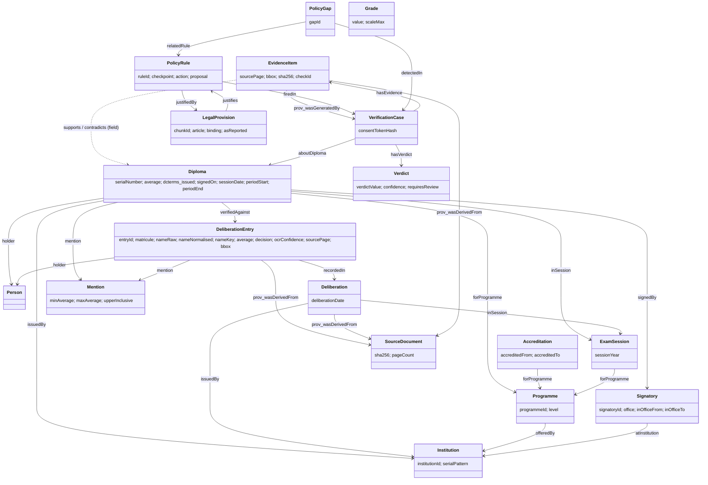

# VeriDiplo ontology and consistency shapes

Files: `app/kg/ontology/veridiplo.ttl` (OWL), `app/kg/shapes/veridiplo-shapes.ttl` (SHACL),
`app/kg/kg_client.py` (Oxigraph / in-memory client), `app/kg/mapping.py` (dict <-> RDF, validation, canned SPARQL).

Namespaces: `vd:` <https://veridiplo.org/ont#>, instances <https://veridiplo.org/id/>, shapes `vds:` <https://veridiplo.org/shapes#>.
Reused vocabularies: PROV-O (`prov:wasDerivedFrom`, `prov:wasGeneratedBy`), Dublin Core Terms (`dcterms:issued`, `dcterms:identifier`, `dcterms:title`),
schema.org (`schema:name`, `schema:birthDate`, `schema:birthPlace`), SKOS (`skos:prefLabel`, `skos:altLabel`, `skos:definition`).
Every class and property has `rdfs:label` in French and English.

All instance data is synthetic. The ontology is also offered as a candidate open schema for diploma and deliberation-minutes data:
no national schema exists in Cameroon for this kind of record (standards gap, see "Standards-gap contribution" below).

## Class diagram



## Classes

| Class | Meaning | Notes |
|---|---|---|
| `vd:Person` | Diploma holder | subclass of `schema:Person`, `prov:Agent`. IRI derived from the token-sorted normalised name (+ birth date when known). |
| `vd:Diploma` | Diploma, either a verifier's claim or a registry record | subclass of `prov:Entity`. |
| `vd:Institution` | Issuing institution | `vd:serialPattern` holds the serial-number regex (token `YYYY` = session year). |
| `vd:Programme` | Degree programme | `vd:offeredBy` is the only authoritative "programme exists at institution" statement. |
| `vd:ExamSession` | Programme + year | |
| `vd:Deliberation` | One PV (deliberation minutes) | |
| `vd:DeliberationEntry` | One PV row | carries page and bbox of the row. |
| `vd:Grade` | Single grade with value and scale | declared for per-course data; not used by the checks yet. |
| `vd:Mention` | Honours band | five individuals (below). |
| `vd:Signatory` | One term of office of a person who signs diplomas | one node per term. |
| `vd:Accreditation` | Accreditation period of a programme | no `accreditedTo` = open-ended. |
| `vd:SourceDocument` | PV scan, registry file, diploma image | `vd:sha256`. |
| `vd:EvidenceItem` | Located evidence: document, page, bbox, sha256 | `vd:supports` / `vd:contradicts` point to a field property IRI (e.g. `vd:mention`). |
| `vd:VerificationCase`, `vd:Verdict` | A verification run and its outcome | `vd:verdictValue` in {CONSISTENT, INCONSISTENT, INSUFFICIENT_EVIDENCE}. |
| `vd:PolicyRule` | Policy-as-code rule | `vd:justifiedBy` -> `vd:LegalProvision` (inverse `vd:justifies`). |
| `vd:PolicyGap` | Decision point with no (or conflicting) rule | |
| `vd:LegalProvision` | A KB chunk of a real legal text | `vd:chunkId` equals `chunk_id` in `kb/chunks/*.jsonl`. |

## Properties

Object properties: `holder`, `issuedBy`, `forProgramme`, `offeredBy`, `inSession`, `recordedIn`, `mention`, `signedBy`, `atInstitution`,
`verifiedAgainst`, `supports`, `contradicts`, `aboutDiploma`, `hasEvidence`, `hasVerdict`, `justifiedBy`, `justifies`, `firedIn`, `detectedIn`, `relatedRule`.

Datatype properties (domain in brackets):

| Property | Range | Used by |
|---|---|---|
| `vd:serialNumber` | string | Diploma |
| `vd:serialPattern` | string (regex) | Institution |
| `vd:average` | decimal | Diploma, DeliberationEntry |
| `vd:mentionRaw` | string | any: label as written (also kept when the label is unknown) |
| `vd:decision`, `vd:matricule`, `vd:entryId`, `vd:ocrConfidence` | string / decimal | DeliberationEntry |
| `vd:nameRaw`, `vd:nameNormalised`, `vd:nameKey`, `vd:birthPlaceNorm` | string | name matching (`nameKey` = normalised tokens sorted, order independent) |
| `vd:institutionId`, `vd:programmeId`, `vd:signatoryId`, `vd:office`, `vd:level` | string | identifiers and descriptors |
| `vd:sessionYear` | integer | ExamSession |
| `vd:sessionDate`, `vd:periodStart`, `vd:periodEnd` | date | Diploma: claimed session date, and the interval materialised by the mapping (the date if known, else 1 Jan - 31 Dec of the year) |
| `vd:deliberationDate` | date | Deliberation |
| `vd:signedOn` | date | Diploma (defaults to `dcterms:issued`) |
| `vd:inOfficeFrom`, `vd:inOfficeTo` | date | Signatory |
| `vd:accreditedFrom`, `vd:accreditedTo` | date | Accreditation |
| `vd:sourcePage`, `vd:bbox` | integer, `"x0,y0,x1,y1"` | EvidenceItem, DeliberationEntry |
| `vd:sha256` | string (64 hex) | SourceDocument, EvidenceItem, Diploma |
| `vd:checkId` | string | EvidenceItem (C1..C8), SHACL shapes |
| `vd:verdictValue`, `vd:confidence`, `vd:requiresReview`, `vd:consentTokenHash` | | Verdict, VerificationCase |
| `vd:ruleId`, `vd:checkpoint`, `vd:action`, `vd:proposal`, `vd:gapId` | | PolicyRule, PolicyGap |
| `vd:chunkId`, `vd:article`, `vd:asReported`, `vd:binding` | | LegalProvision |
| `vd:minAverage`, `vd:maxAverage`, `vd:upperInclusive`, `vd:scaleMax` | decimal / boolean | Mention bands |

Additions beyond CLAUDE.md 4.1 (needed by the checks): `vd:offeredBy`, `vd:atInstitution`, `vd:verifiedAgainst`, `vd:signedOn`, `vd:serialPattern`,
`vd:nameKey` and the other name/identifier helpers, `vd:periodStart/End`, `vd:firedIn`, `vd:detectedIn`, `vd:relatedRule`, `vd:justifies`, `vd:hasEvidence`, `vd:hasVerdict`, `vd:aboutDiploma`.

`vd:verifiedAgainst` (Diploma -> DeliberationEntry) is asserted by the retrieval/consistency agents once check C1 has matched a diploma to a PV entry.
C2, C4 (PV comparison) and C5 only run when this link exists.

## Mention bands (documented policy parameter)

Bands are data on the `vd:Mention` individuals (scale /20), so a change of policy is a change to `veridiplo.ttl`, not to code.

| Individual | FR label | Band | English honours labels (proposed equivalence) |
|---|---|---|---|
| `vd:Ajourne` | Ajourné | [0, 10) | Fail |
| `vd:Passable` | Passable | [10, 12) | Pass, Third Class |
| `vd:AssezBien` | Assez Bien | [12, 14) | Lower Second Class, Second Class Lower (Division), Fairly Good, Credit |
| `vd:Bien` | Bien | [14, 16) | Upper Second Class, Second Class Upper (Division), Good |
| `vd:TresBien` | Très Bien | [16, 20] | First Class (Honours), Distinction, Very Good |

The English mapping is our proposal: Anglophone Cameroonian institutions use UK-style classes and often a GPA scale, and no national equivalence table exists.
`mapping.mention_iri(label)` resolves labels (any case, accents ignored) through these `skos:prefLabel` / `skos:altLabel` values.

## Consistency checks to shapes

| Check | Shape(s) | Violation when |
|---|---|---|
| C1 name match | not in SHACL (fuzzy, Python) | |
| C2 birth | `vds:C2_BirthShape`, `vds:PersonShape` | birth date / normalised place differ between the diploma holder and the PV holder; a person has two birth dates |
| C3 accreditation | `vds:C3_AccreditationShape` | programme not offered by the issuing institution; no accreditation period overlaps the session (the date if known, otherwise the whole year) |
| C4 average/mention | `vds:C4_BandShape`, `vds:C4_PVMatchShape` | mention outside the band of the average (diploma and PV entries); diploma average (> 0.005) or mention differs from the PV entry |
| C5 dates | `vds:C5_DatesShape` | issued before the deliberation date; session year differs from the PV; issued before the session year |
| C6 signatory | `vds:C6_SignatoryShape` | signing date outside the term of office; signatory serves at another institution |
| C7 serial | `vds:C7_SerialShape` | serial does not match the institution pattern; same serial held by a different holder (SPARQL-based uniqueness) |
| C8 image hints | not in SHACL | |
| (structure) | `vds:EvidenceItemShape`, `DiplomaShape`, `VerdictShape`, `PolicyRuleShape`, ... | EvidenceItem lacks sha256 / page / bbox / `prov:wasDerivedFrom`; verdict value invalid or INCONSISTENT without `requiresReview`; policy rule with neither `justifiedBy` nor `proposal true` |

Notes: C7 uniqueness is symmetric, so when two holders share a serial both diplomas are reported. A diploma and its registry copy with the same holder are not duplicates.
A missing optional input (no signatory, no accreditation data in the graph for C3's date test, no verified entry) yields no violation: the ConsistencyAgent maps absent data to `unknown`.
Each report item holds `check_id` (from the shape's `vd:checkId`), `focus_node`, `message_fr`, `message_en`.

## Usage

```python
from app.kg import mapping, kg_client
g = mapping.institution_to_rdf(inst)            # programmes, accreditations, signatories nested
mapping.entry_to_rdf(pv_entry, g)               # OCR agent entry contract
mapping.diploma_to_rdf(diploma_fields, g)       # verified_against=[entry_id] after C1
conforms, report = mapping.validate(g)          # pyshacl; report items carry check_id
kg = kg_client.get_kg()                         # Oxigraph at KG_URL, else in-memory (KG_BACKEND=memory forces it)
mapping.load_into_kg(g, kg)
mapping.find_entries_by_name("KAMGA ERIC", institution="UFN", year=2016, kg=kg)
```

Oxigraph: ontology and data live in two named graphs (`https://veridiplo.org/graph/ontology`, `.../graph/data`). The client sends them as `default-graph-uri`
on every query, so the server does not need `--union-default-graph` (it is compatible with it; set `KG_UNION_DEFAULT=1` to skip the dataset parameters).

## Competency questions

```sparql
PREFIX vd: <https://veridiplo.org/ont#>
PREFIX skos: <http://www.w3.org/2004/02/skos/core#>
PREFIX dcterms: <http://purl.org/dc/terms/>
PREFIX prov: <http://www.w3.org/ns/prov#>
PREFIX schema: <https://schema.org/>
```

1. Which PV entries match a (normalised, order-independent) name at an institution in a year? (`mapping.find_entries_by_name`)
```sparql
SELECT ?entry ?average ?mention ?page ?bbox ?document WHERE {
  ?entry a vd:DeliberationEntry ; vd:nameKey "ERIC KAMGA" ; vd:average ?average ;
         vd:sourcePage ?page ; vd:bbox ?bbox ; prov:wasDerivedFrom ?document ;
         vd:recordedIn/vd:issuedBy/vd:institutionId "UFN" ; vd:inSession/vd:sessionYear 2016 .
  OPTIONAL { ?entry vd:mention/skos:prefLabel ?mention FILTER(LANG(?mention) = "fr") }
}
```
2. Was the programme accredited at the institution during a session? (`mapping.programme_accreditation`)
```sparql
SELECT ?accreditation ?from ?to WHERE {
  ?p vd:programmeId "UFN-LIC-GC" ; vd:offeredBy/vd:institutionId "UFN" .
  ?accreditation vd:forProgramme ?p ; vd:accreditedFrom ?from .
  OPTIONAL { ?accreditation vd:accreditedTo ?to }
}
```
3. Was the signatory in office at the signing date? (`mapping.signatory_in_office`)
```sparql
SELECT ?s ?from ?to WHERE {
  ?s vd:signatoryId "SIG-A" ; vd:inOfficeFrom ?from . OPTIONAL { ?s vd:inOfficeTo ?to }
  FILTER(?from <= "2016-11-10"^^xsd:date && (!BOUND(?to) || ?to >= "2016-11-10"^^xsd:date))
}
```
4. Which serial numbers are held by more than one holder? (`mapping.duplicate_serials`)
```sparql
SELECT ?serial (COUNT(DISTINCT ?k) AS ?holders) WHERE {
  ?d a vd:Diploma ; vd:serialNumber ?serial ; vd:holder/vd:nameKey ?k .
} GROUP BY ?serial HAVING (COUNT(DISTINCT ?k) > 1)
```
5. Which diplomas contradict their PV on the mention?
```sparql
SELECT ?d ?claimed ?recorded WHERE {
  ?d vd:verifiedAgainst ?e ; vd:mention ?claimed . ?e vd:mention ?recorded . FILTER(?claimed != ?recorded)
}
```
6. Which legal text justifies a policy rule, and which rules rest on a non-binding or "as reported" provision?
```sparql
SELECT ?rule ?chunk ?article ?binding ?asReported WHERE {
  ?r a vd:PolicyRule ; vd:ruleId ?rule ; vd:justifiedBy ?l . ?l vd:chunkId ?chunk .
  OPTIONAL { ?l vd:article ?article } OPTIONAL { ?l vd:binding ?binding } OPTIONAL { ?l vd:asReported ?asReported }
}
```
7. Which policy rules fired in a case, and which gaps were recorded?
```sparql
SELECT ?rule ?gap WHERE {
  { ?r vd:firedIn <https://veridiplo.org/id/case/CASE-1> ; vd:ruleId ?rule }
  UNION { ?g vd:detectedIn <https://veridiplo.org/id/case/CASE-1> ; vd:gapId ?gap }
}
```
8. Which evidence items cite a given page of a given document, with hash and box?
```sparql
SELECT ?ev ?page ?bbox ?sha WHERE {
  ?ev a vd:EvidenceItem ; prov:wasDerivedFrom <https://veridiplo.org/id/document/PV-UFN-LIC-INFO-2016> ;
      vd:sourcePage ?page ; vd:bbox ?bbox ; vd:sha256 ?sha .
}
```

## Standards-gap contribution

No national schema (Cameroon or ITU) defines machine-readable diploma, deliberation-minutes, accreditation or signatory-term records. As a result:
(1) registries cannot be queried across institutions, (2) honours bands and English/French equivalences are undocumented, (3) serial-number formats are institution-specific and unpublished,
(4) terms of office and accreditation periods are not published as data, so checks C3 and C6 need manual archive work.
This ontology and the SHACL shapes are a concrete, MIT-licensed starting proposal for such a schema. It is a proposal, not a standard.
